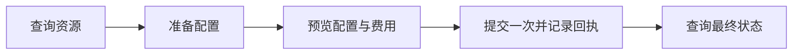

<h1 align="center">AutoDL 实例与镜像管理</h1>

<p align="center">在 Codex 中完成登录、资源查询、实例创建、同区域克隆与镜像保存。</p>

<p align="center">
  
  
  
</p>

<p align="center">
  <a href="#快速开始">快速开始</a> ·
  <a href="#登录方式">登录方式</a> ·
  <a href="#常用命令">常用命令</a> ·
  <a href="#创建与迁移">创建与迁移</a> ·
  <a href="#自动更新">自动更新</a> ·
  <a href="#开发与验证">开发与验证</a>
</p>

## 功能一览

| 能力 | 可以完成的操作 |
| --- | --- |
| 登录 | 主账号微信扫码、短信验证码，子账号密码登录 |
| 实例 | 查看配置与 SSH 连接命令，按实例 UUID 开关机 |
| 资源 | 查询区域、GPU 主机、基础镜像、私有与共享镜像 |
| 创建与迁移 | 创建普通容器、同区域克隆、保存系统盘镜像 |
| 费用与订单 | 查看报价和镜像用量，预览并支付创建 / 克隆订单 |
| 更新 | 每次使用检查 GitHub，自动更新；网络失败时静默使用本地版本 |

适用于 AutoDL 普通容器实例。Container Instance Pro、跨实例文件传输和训练恢复由对应工具或项目负责。

## 快速开始

### 安装到 Codex

在 PowerShell 中运行：

```powershell
$codexDir = if ($env:CODEX_HOME) { $env:CODEX_HOME } else { Join-Path $env:USERPROFILE ".codex" }
$skillDir = Join-Path $codexDir "skills\autodl-instance"

git clone https://github.com/konglingyi11/autodl-skills.git $skillDir
Set-Location $skillDir

python -m pip install curl_cffi playwright pillow
python -m playwright install chromium
```

短信登录还需要 tkinter，常规 Windows Python 安装已包含；缺少时在 Python 安装程序中启用 Tcl/Tk。仅使用子账号 HTTP 登录时，安装 `curl_cffi` 即可。

### 在 Codex 中使用

调用 `$autodl-instance` 并说明要操作的资源，例如：

```text
使用 $autodl-instance，通过微信登录，列出我的实例。
```

```text
使用 $autodl-instance，查看这个实例的配置，寻找同区域可用主机并生成克隆预览。
```

### 直接使用命令行

从技能根目录运行，先试一次只读查询：

```powershell
python scripts/autodl_instance.py --auth wechat list
```

统一命令格式：

```text
python scripts/autodl_instance.py [--auth sub|wechat|sms] <命令> [参数]
```

## 登录方式

`--auth` 放在操作命令之前。每次命令独立登录，令牌仅保存在当前进程，退出时关闭浏览器并清理临时二维码。

| 方式 | 命令示例 | 操作 |
| --- | --- | --- |
| 微信 · 主账号 | `--auth wechat list` | 在 Codex 中扫描二维码，登录后自动继续 |
| 短信 · 主账号 | `--auth sms list` | 在本机窗口完成图形验证、填写短信验证码并登录 |
| 密码 · 子账号，默认 | `list` 或 `--auth sub list` | 从进程环境变量读取子账号和密码 |

### 微信扫码

脚本使用无头 Chromium，输出二维码图片的绝对路径，由 Codex 助手显示到聊天中。微信扫码后自动执行原命令，最多等待 5 分钟；过期后重新运行命令获取新二维码。

### 短信验证码

1. 在本机可交互终端输入手机号，输入不回显。
2. 在“AutoDL 短信登录”窗口点击“发送验证码”，按官方要求完成图形验证。
3. 在同一窗口填写短信验证码并点击“登录”；支持键盘输入和 Ctrl+V 粘贴。

登录成功后窗口自动关闭，终端输出结果；关闭窗口或点击“取消登录”会终止操作。底层浏览器始终无头运行，用户在本机窗口中完成官方验证。手机号、验证码和密码均在本机输入。

<details>
<summary><strong>配置子账号环境变量</strong></summary>

子账号格式为 `<用户名>@<主账号ID>`。在当前 PowerShell 会话中配置：

```powershell
$env:AUTODL_SUB_ACCOUNT = Read-Host "子账号（用户名@主账号ID）"
$env:AUTODL_SUB_PASSWORD = [System.Net.NetworkCredential]::new("", (Read-Host "子账号密码" -AsSecureString)).Password
python scripts/autodl_instance.py list
```

密码从隐藏输入读取到进程环境中，供 HTTP 登录使用。凭据、实例密码与 `.env` 文件应保留在仓库之外。

</details>

## 常用命令

下表省略统一前缀 `python scripts/autodl_instance.py`。主账号在命令前加 `--auth wechat` 或 `--auth sms`。

| 对象 | 命令 |
| --- | --- |
| 实例列表与 SSH 命令 | `list` |
| 实例配置与镜像快照 | `detail <实例UUID>` |
| 开机 / 关机 | `start <实例UUID>` / `stop <实例UUID>` |
| 当前账号可见的私有与共享镜像 | `images` |
| 镜像空间与当日预计费用 | `image-usage` |
| 官方镜像计费规则，无需登录 | `image-billing` |
| 区域目录 | `regions` |
| 区域内指定 GPU 主机 | `machines --region <区域标识> --gpu <型号>` |
| 指定物理主机 | `machines --machine-id <主机ID>` |
| 基础镜像元数据 | `base-image <镜像UUID>` |
| 订单状态 | `order <订单UUID>` |

`list` 默认隐藏 SSH 密码，确有需要时使用 `list --show-ssh-password`。主机 ID、实例 UUID、镜像 UUID 和订单 UUID 分别对应不同对象。开关机前核对准确的实例与状态，提交后通过 `list` 查看最终结果。

## 创建与迁移

创建、克隆、保存镜像与订单支付共用同一条流程：



| 操作 | 预览命令 | 完成后查询 |
| --- | --- | --- |
| 创建实例 | `create --config create.json` | `list` / `detail` |
| 同区域克隆 | `clone <源实例UUID> --config clone.json` | `list` / `detail` |
| 保存系统盘镜像 | `save-image <源实例UUID> --name <镜像名称>` | `images` |
| 支付创建 / 克隆订单 | `pay-order <订单UUID>` | `order`，再查询实例 |

上述命令默认只生成预览。授权覆盖具体配置和费用后，在同一命令后追加：

```text
--execute --request-sha256 <预览返回的指纹> --receipt <新的绝对回执路径.json>
```

执行前会重新核对状态、请求与报价，写入回执后仅提交一次。`ACCEPTED` 表示服务端接受请求；`SUBMITTING` 表示结果尚未确认，需要结合回执核对远端资源再决定下一步。

克隆需明确是否复制数据盘；保存镜像包含系统盘。克隆和保存镜像要求源实例已关机。预付费创建 / 克隆先生成订单，支付单独执行。

→ [查看配置示例、磁盘范围、计费和异常处理](references/create-and-migrate.md)

## 自动更新

更新源为本仓库的 `main` 分支，检查在每次使用 skill 或运行命令时进行。

| 情况 | 处理方式 |
| --- | --- |
| 已是最新 | 仅检查版本，不重复下载 |
| 发现新版本 | 自动更新，同一次命令使用新代码 |
| 网络超时、限流或权限不足 | 静默继续使用本地版本 |
| 本地文件有改动 | 保留本地内容，跳过覆盖 |

更新检查不弹窗，不向正常 JSON 输出插入提示；检查和下载采用短超时，不自动重试。Git 安装使用干净 `main` 分支的快进更新，普通目录安装使用发行清单校验和本地更新状态。`.env`、回执和业务文件保留在更新范围之外。

<details>
<summary><strong>开发或离线调试时暂停检查</strong></summary>

```powershell
$env:AUTODL_AUTO_UPDATE = "0"
```

恢复检查：

```powershell
Remove-Item Env:AUTODL_AUTO_UPDATE
```

</details>

## 开发与验证

| 入口 | 内容 |
| --- | --- |
| [SKILL.md](SKILL.md) | Codex 调用规则 |
| [创建与迁移流程](references/create-and-migrate.md) | 资源配置、预览、提交、回执与完成核验 |
| [HTTP 接口与证据](references/http-api.md) | 官方接口来源、账号路由、字段和验证范围 |
| [scripts/](scripts/) | 命令行、认证、资源操作、更新与离线测试 |

<details>
<summary><strong>验证记录与检查命令</strong></summary>

| 项目 | 已有证据 |
| --- | --- |
| 微信 → 主账号实例列表 | 2026-11-09 实测成功，返回空列表 |
| 短信 → 主账号实例列表 | 2026-11-09 用户在本机完成操作并确认显示实例列表 |
| 登录窗口与自动更新 | 本地合成页面、安装包和 Git 仓库测试 |
| 创建、克隆、保存镜像、支付 | 离线契约测试；真实付费操作尚未实测 |

运行离线测试：

```powershell
python -m unittest discover -s scripts -p "test_autodl*.py"
```

启用本机窗口集成检查，需要已安装 Chromium、tkinter 和 Pillow：

```powershell
$env:AUTODL_TEST_GUI = "1"
python -m unittest discover -s scripts -p "test_autodl*.py"
Remove-Item Env:AUTODL_TEST_GUI
```

测试使用本地合成页面，不访问真实账号或发送短信。修改 skill 后，用 `skill-creator` 提供的 `quick_validate.py` 校验仓库根目录。

</details>

<details>
<summary><strong>源码结构与发布</strong></summary>

```text
autodl-skills/
├── SKILL.md                         Codex 技能入口
├── scripts/
│   ├── autodl_instance.py           命令行、HTTP 客户端与实例操作
│   ├── autodl_auth.py               无头登录、二维码与短信窗口
│   ├── autodl_resources.py          查询、预览、提交与回执
│   ├── autodl_update.py             静默更新与发行清单生成
│   └── test_autodl*.py              离线与本地集成检查
├── references/                      操作流程与接口依据
├── agents/openai.yaml               技能展示元数据
└── update-manifest.json             发行文件校验基线
```

发布前重新生成清单，再将改动与清单一起提交到 GitHub `main`：

```powershell
python scripts/autodl_update.py --build-manifest
```

普通目录安装需完整复制 `SKILL.md`、`README.md`、`scripts/`、`references/`、`agents/` 和 `update-manifest.json`。本地 `.autodl-update.*` 状态保留在安装目录，不提交到仓库。工作区改动不会自动发布到 GitHub。

</details>
